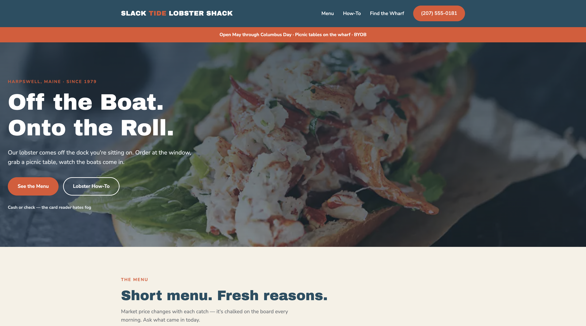

# Slack Tide Lobster Shack 🦞

A one-page website for a lobster shack on the Maine coast, with a menu, a guide to eating a whole lobster, and directions to the wharf.

## Description

This is a project I built to practice designing a full landing page with HTML and CSS only. It's a website for a made-up seasonal lobster shack in Harpswell, Maine. The page has a header with a menu and a phone button, an announcement bar, a big photo section with the headline "Off the Boat. Onto the Roll.", the menu, a step-by-step guide to eating a whole lobster, the hours and location, and a footer. The shop's name, address, and phone number are sample content for practice. There is no JavaScript and no server to run.

## Screenshot

## Features

- Navy header with the shop name and a menu: Menu, How-To, and Find the Wharf
- Orange phone button in the header
- Announcement bar with the season and what to know before you come
- Hero section with a lobster roll photo, a dark overlay so the text is easy to read, and two buttons
- A short menu in two cards: "From the Water" and "Sides & Sweets"
- A "How to eat the whole thing" guide with four numbered steps
- A "Find the Wharf" section with the hours, the address, and tips for visitors
- Footer with the shop's details and a "Back to top" link
- Bold headline font with a clean body font, in navy, orange, and cream

## Tech Used

- HTML
- CSS (flexbox)
- Google Fonts (Archivo Black and Nunito Sans)

## How to Use

This site doesn't need a server or an API key.

1. Download or clone the project.
2. Open `maine-lobster.html` in your browser (or use the Live Server extension in VS Code). It needs an internet connection to load the fonts.
3. Scroll through the page.

**Please note:** the menu links and buttons don't go anywhere yet, and the layout is designed for a computer screen and isn't adjusted for phones yet.

## How It Works

1. `maine-lobster.html` is organized with a `header`, a `main` that holds the sections, and a `footer`.
2. `style.css` sets the colors, fonts, and spacing for the whole page, and the same button and card styles are reused in different sections.
3. The hero section uses a photo as its background with a dark gradient over it, so the white text stays readable.
4. The menu, how-to steps, and info boxes are laid out in rows of cards with flexbox.

## What I Learned

- How to plan a full page with sections that each have their own job
- How to use a background photo with a gradient overlay
- How to reuse button and card styles across the page
- How to lay out rows of cards with flexbox
- How to add fonts from Google Fonts
- How to write friendly page copy that fits a brand

VIEW APP HERE: https://maine-lobster.onrender.com/

## Author

Maya Rose 🌹
